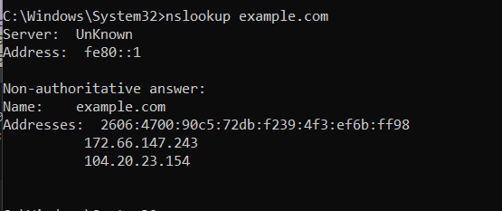
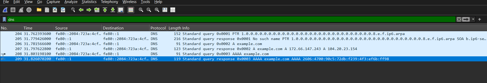
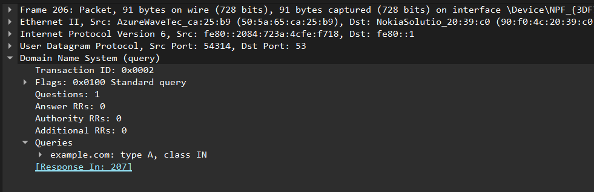
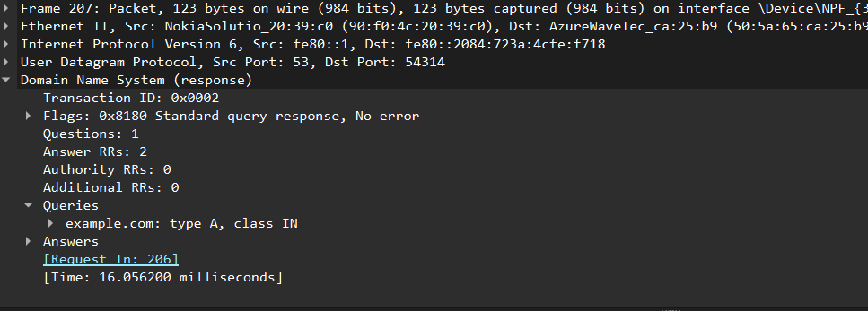

# DNS Query and Response Analysis

## Objective

The objective of this lab is to capture and analyze DNS query and response traffic using Wireshark. The practical focuses on understanding how DNS resolves domain names into IP addresses and how a client communicates with a DNS resolver.

The investigation includes analyzing DNS transaction IDs, query types, UDP ports, DNS flags, response codes, and returned resource records (A and AAAA).

## Environment

| Component | Details |
|---|---|
| Operating System | Windows |
| Analysis Tool | Wireshark |
| Command-Line Tool | Windows Command Prompt |
| Protocol | DNS |
| Transport Protocol | UDP |
| Target Domain | `example.com` |
| DNS Server Address | `fe80::1` |
| DNS Server Port | 53 |

## Methodology

The following steps were performed during the investigation:

1. Started packet capture on the active Wi-Fi/Ethernet network interface.
2. Flushed the local DNS resolver cache using `ipconfig /flushdns`.
3. Generated DNS traffic using `nslookup example.com`.
4. Applied the Wireshark display filter `dns`.
5. Identified DNS query and response packets.
6. Investigated A and AAAA record exchanges.
7. Examined transaction IDs, UDP ports, DNS flags, response codes, and answer records.
8. Saved the packet capture and screenshots as investigation evidence.

## Commands Executed

### 1. Flush DNS Cache

```cmd
ipconfig /flushdns
```

This command clears the local Windows DNS resolver cache, helping generate fresh DNS resolution requests.

### 2. Perform DNS Lookup

```cmd
nslookup example.com
```

The command requests DNS resolution for `example.com` and displays the configured DNS server and returned IP addresses.

### Command Output

The DNS lookup completed successfully. The command output displayed the configured DNS resolver and the IP address information returned for `example.com`. The observed output is documented below.

**DNS Server:**
- Address: `fe80::1`
- Hostname: Unknown

**Resolved IPv4 Address:**
- `172.66.147.243`

**Resolved IPv6 Address:**
- `2606:4700:90c5:72db:f239:4f3:ef6b:ff98`

The configured DNS server address was `fe80::1`, an IPv6 link-local address. Link-local addresses are used for communication within the local network segment and are not globally routable. The DNS server hostname was displayed as Unknown by `nslookup`, which does not necessarily indicate a DNS server problem.

### Screenshot 1 — Nslookup Output



## Wireshark Capture and Filtering

The DNS packets were captured on the active network interface.

The following display filter was applied:

```wireshark
dns
```

This filter displays DNS packets captured during the investigation.

### Screenshot 2 — DNS Packet Capture



## DNS Query Analysis

Two primary DNS queries for `example.com` were identified.

### Packet 206 — A Record Query

The first query requested an IPv4 address for `example.com`.

| Field | Observed Value |
|---|---|
| Packet Number | 206 |
| Transaction ID | `0x0002` |
| Query Name | `example.com` |
| Query Type | A |
| Source Port | 54314 |
| Destination Port | 53 |
| Transport Protocol | UDP |
| DNS Flags | `0x0100` |
| Query Type | Standard Query |

**Flag Analysis:**

The DNS flags value `0x0100` indicates:

- QR = 0: DNS query.
- RD = 1: Recursion Desired.

The Recursion Desired (RD) flag represents a request from the client asking the DNS resolver to perform recursive resolution if necessary. This flag indicates the client's preference and does not guarantee that recursion will be performed.

### Screenshot 3 — Expanded DNS Query Details



### Packet 208 — AAAA Record Query

The second query requested an IPv6 address for `example.com`.

| Field | Observed Value |
|---|---|
| Packet Number | 208 |
| Transaction ID | `0x0003` |
| Query Name | `example.com` |
| Query Type | AAAA |
| Source Port | 54315 |
| Destination Port | 53 |
| Transport Protocol | UDP |

An AAAA record is used to retrieve an IPv6 address associated with a domain name.

## DNS Response Analysis

The corresponding DNS responses were identified and investigated.

### Packet 207 — A Record Response

The response matched the original A record query.

| Field | Observed Value |
|---|---|
| Packet Number | 207 |
| Transaction ID | `0x0002` |
| Query Name | `example.com` |
| Query Type | A |
| Source Port | 53 |
| Destination Port | 54314 |
| DNS Flags | `0x8180` |
| Response Code | NOERROR |
| Answer Count | 2 |

**Returned IPv4 Addresses:**

1. `172.66.147.243`
2. `104.20.23.154`

**Observation:** The `nslookup` output displayed one IPv4 address, while the captured A record response in Wireshark contained two IPv4 resource records. This difference was noted for further investigation rather than assuming that both observations represented identical DNS response data.

**Flag Analysis:**

The DNS response flags value `0x8180` indicates:

- QR = 1: DNS response.
- Opcode = 0: Standard query.
- AA = 0: Non-authoritative response.
- TC = 0: Response not truncated.
- RD = 1: Recursion was requested.
- RA = 1: Recursion Available. The DNS server indicates that recursive queries are supported. This is different from RD, which represents the client's request for recursion.
- RCODE = 0: No error.
   
The DNS server successfully processed the query and returned two IPv4 resource records.

### Screenshot 4 — Expanded DNS Response Details



### Packet 209 — AAAA Record Response

The response matched the original AAAA record query.

| Field | Observed Value |
|---|---|
| Packet Number | 209 |
| Transaction ID | `0x0003` |
| Query Name | `example.com` |
| Query Type | AAAA |
| Source Port | 53 |
| Destination Port | 54315 |
| DNS Flags | `0x8180` |
| Response Code | NOERROR |
| Answer Count | 1 |

**Returned IPv6 Address:**

`2606:4700:90c5:72db:f239:4f3:ef6b:ff98`

The DNS server successfully returned one IPv6 resource record.

## Query and Response Comparison

The following table summarizes the observed DNS exchanges:

| Packet | Transaction ID | Type | Description |
|---|---|---|---|
| 206 | `0x0002` | A | DNS Query |
| 207 | `0x0002` | A | DNS Response |
| 208 | `0x0003` | AAAA | DNS Query |
| 209 | `0x0003` | AAAA | DNS Response |

Both query-response pairs had matching transaction IDs.

The client used different ephemeral source ports for the two queries, while the DNS server used UDP port 53 for its responses.

## A Record vs AAAA Record

| Feature | A Record | AAAA Record |
|---|---|---|
| Purpose | IPv4 resolution | IPv6 resolution |
| Address Type | IPv4 | IPv6 |
| Query Transaction ID | `0x0002` | `0x0003` |
| Returned Records | 2 | 1 |
| Transport | UDP | UDP |

## DNS Transport Protocols

DNS commonly uses UDP port 53 for standard queries because UDP has low communication overhead. However, DNS can also use TCP port 53 in situations such as responses requiring reliable transport or zone transfers.

Encrypted DNS protocols provide additional privacy:

- **DNS over TLS (DoT):** Commonly uses TCP port 853.
- **DNS over HTTPS (DoH):** Uses HTTPS, commonly over TCP port 443.

The DNS exchanges observed in this investigation used UDP port 53. DNS over TCP, DoT, and DoH were not investigated in this practical.


## Additional DNS Traffic Observed

During the capture, additional PTR-related DNS traffic was observed in packets 204 and 205.

PTR records are used for reverse DNS lookups, which map IP addresses back to domain names.

These packets were not part of the primary A and AAAA query-response exchanges investigated in this lab.

## SOC Analyst Observations

From a Security Operations Center (SOC) perspective, the following observations were made:

1. **DNS Communication:** The client communicated with its configured DNS resolver using UDP port 53.

2. **Transaction ID Matching:** The DNS query and corresponding response packets had matching transaction IDs, allowing the exchanges to be correlated.

3. **IPv4 and IPv6 Resolution:** Both A and AAAA queries were generated for the same domain.

4. **Successful Resolution:** Both DNS responses returned the NOERROR response code.

5. **Multiple DNS Answers:** The A record response contained two IPv4 addresses, while the AAAA response contained one IPv6 address.

6. **Recursive Resolution:** The client set the Recursion Desired flag, and the resolver indicated that recursion was available.

7. **Repeated DNS Requests:** Repeated requests to an unusual domain may warrant further investigation, even when the responses return NOERROR. An analyst should examine domain reputation, query frequency, requesting process, source host, returned IP addresses, and communication patterns.

8. **Contextual Investigation:** DNS response codes alone cannot establish whether a domain is malicious. DNS activity should be correlated with endpoint telemetry, network traffic, and threat intelligence before drawing conclusions.

## Security Relevance

DNS is an important protocol for SOC analysts because attackers can abuse DNS communication for activities such as:

- DNS tunneling.
- Command-and-Control (C2) communication.
- DNS spoofing and poisoning.
- Domain Generation Algorithm (DGA) activity.
- Suspicious or malicious domain resolution.

A SOC analyst can investigate DNS traffic by examining queried domains, destination DNS servers, query frequency, response codes, unusual record types, and communication patterns.

A successful DNS response alone does not establish that a domain is safe or malicious. Additional investigation and threat intelligence are required.

## Limitations

- The investigation focused on DNS query and response analysis.
- Only the observed packets from the selected capture were examined.
- No malware execution or malicious DNS activity was tested.
- DNS over HTTPS (DoH) and DNS over TLS (DoT) were not investigated.
- The returned IP addresses were recorded from the captured traffic and were not independently validated for reputation.

## Conclusion

This practical demonstrated how DNS resolves domain names into IP addresses through query and response communication.

Using Wireshark, both A and AAAA record exchanges for `example.com` were captured and analyzed.

The investigation identified DNS transaction IDs, UDP source and destination ports, DNS flags, response codes, and returned IPv4 and IPv6 addresses.

The matching transaction IDs confirmed the relationship between the DNS queries and their corresponding responses.

This exercise provided practical experience in network traffic analysis and understanding DNS communication from a SOC analyst's perspective.

## Evidence Files

- `dns-query-response.pcapng` — Original Wireshark packet capture.
- `Screenshots/` — Screenshots documenting DNS queries, responses, packet details, and command output.


