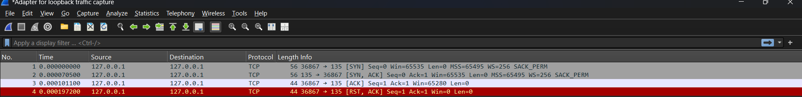
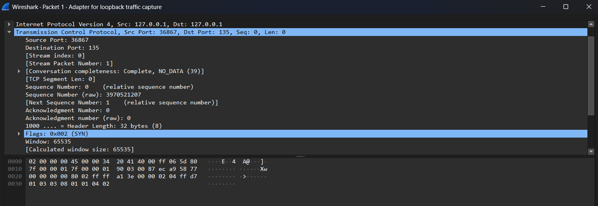
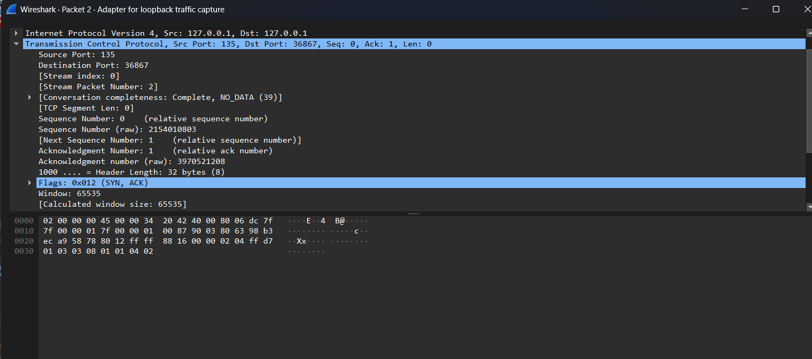
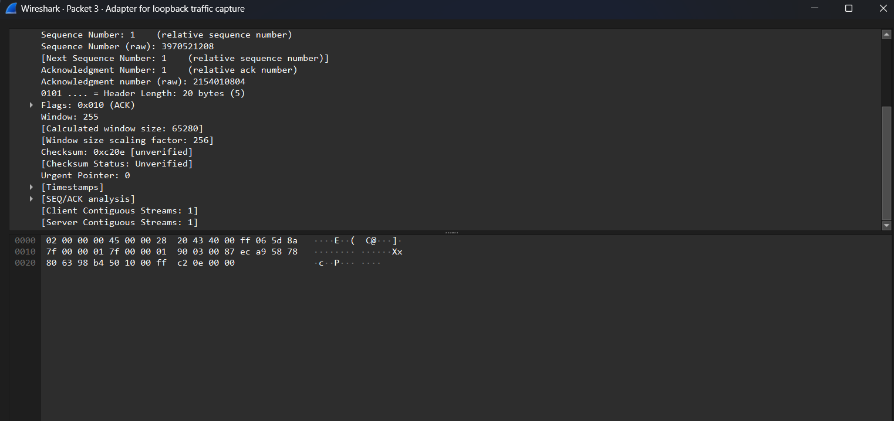

# TCP Three-Way Handshake Analysis

## Objective

The objective of this lab is to capture and analyze the TCP Three-Way Handshake using Wireshark.

The TCP Three-Way Handshake is the process used by the Transmission Control Protocol (TCP) to establish a reliable connection between a client and a server before data transmission begins.

This lab focuses on:

- Understanding the three stages of TCP connection establishment.
- Identifying SYN, SYN-ACK, and ACK packets.
- Examining TCP flags, source and destination ports, and sequence numbers.
- Understanding how Wireshark can be used for network traffic analysis.
- Recognizing the security relevance of TCP connection monitoring.

## Environment

| Component | Details |
|---|---|
| Operating System | Windows 10 64-bit |
| Packet Analyzer | Wireshark 4.6.9 |
| Network Protocol | TCP |
| Capture Tool | Wireshark |
| Capture Interface | [Enter interface name] |
| Target IP | [Enter target IP] |
| Source IP | [Enter source IP] |

## Capture Method

1. Open Wireshark with the appropriate network interface.
2. Start capturing network traffic.
3. Generate a TCP connection to the target machine or service.
4. Allow the connection establishment packets to be captured.
5. Stop the capture after obtaining the required packets.
6. Apply the following Wireshark display filter:

```text
tcp.flags.syn == 1 || tcp.flags.ack == 1
```

7. Identify the three packets involved in the TCP Three-Way Handshake.

**Screenshot 1 — Overall Packet Capture**



*Figure 1: Wireshark capture showing the TCP connection establishment packets.*

## Packet 1 — SYN

**Purpose:** Connection Initiation

The first packet is sent by the client to initiate a TCP connection with the server.

The client sends a SYN (Synchronize) packet to request a connection.

Important observations:

- TCP Flag: SYN = 1
- ACK = 0
- Source Port: [Enter source port]
- Destination Port: [Enter destination port]
- Sequence Number: [Enter sequence number]

**Analysis:**

The SYN packet indicates that the client wants to establish a TCP connection with the destination server.

The initial sequence number is used to synchronize communication between both endpoints.

**Screenshot 2 — SYN Packet Details**



*Figure 2: Wireshark packet details showing the initial SYN request and TCP flags.*

## Packet 2 — SYN-ACK

**Purpose:** Server Response

The second packet is sent by the server in response to the client's SYN request.

The server acknowledges the client's request and sends its own synchronization request.

Important observations:

- TCP Flags: SYN = 1, ACK = 1
- Source Port: [Enter source port]
- Destination Port: [Enter destination port]
- Sequence Number: [Enter sequence number]
- Acknowledgment Number: [Enter acknowledgment number]

**Analysis:**

The SYN-ACK packet indicates that the server has received the client's connection request and is willing to establish the connection.

The acknowledgment number generally equals the client's initial sequence number plus one.

The server also provides its own initial sequence number.

**Screenshot 3 — SYN-ACK Packet Details**



*Figure 3: Wireshark packet details showing the server's SYN-ACK response.*

## Packet 3 — ACK

**Purpose:** Connection Establishment

The third packet is sent by the client to acknowledge the server's SYN-ACK response.

This completes the TCP Three-Way Handshake.

Important observations:

- TCP Flag: ACK = 1
- SYN = 0
- Source Port: [Enter source port]
- Destination Port: [Enter destination port]
- Sequence Number: [Enter sequence number]
- Acknowledgment Number: [Enter acknowledgment number]

**Analysis:**

The final ACK packet confirms that the client has received and acknowledged the server's response.

At this point, the TCP connection is established, and both endpoints can begin exchanging application data.

**Screenshot 4 — ACK Packet Details**



*Figure 4: Wireshark packet details showing the final ACK packet.*

## Analysis

The TCP Three-Way Handshake consists of three packets exchanged between the client and server.

| Stage | Sender | TCP Flag | Purpose |
|---|---|---|---|
| 1 | Client | SYN | Initiates connection |
| 2 | Server | SYN-ACK | Acknowledges request and synchronizes |
| 3 | Client | ACK | Acknowledges server response |

The handshake follows this sequence:

```text
         CLIENT                         SERVER
            |                              |
            | -------- SYN ------------->  |
            |                              |
            | <------ SYN-ACK ------------ |
            |                              |
            | -------- ACK ------------->  |
            |                              |
            |                       CONNECTION
            |                        ESTABLISHED
```

Key findings:

1. The client initiates the connection using a SYN packet.
2. The server responds with a SYN-ACK packet.
3. The client sends the final ACK packet.
4. The connection is established after the three-way exchange.
5. TCP sequence and acknowledgment numbers help ensure reliable communication.

## Security Relevance

Understanding TCP Three-Way Handshake behavior is important for network security monitoring and SOC operations.

Some security-related observations include:

**1. SYN Flood Attacks**

An attacker may send a large number of SYN requests without completing the handshake.

This can cause the server to maintain numerous half-open connections and potentially exhaust available resources.

**2. Port Scanning Detection**

Tools such as Nmap initiate TCP connection attempts to identify open, closed, or filtered ports.

Monitoring SYN, SYN-ACK, and RST packets can help security analysts identify potential reconnaissance activity.

**3. Suspicious Connection Monitoring**

Unexpected connection attempts, repeated SYN packets, and unusual connection patterns may indicate suspicious network behavior.

**4. Network Traffic Investigation**

Wireshark allows analysts to inspect TCP flags, IP addresses, ports, and connection sequences to investigate network activity.

## What I Learned

After completing this lab, I learned:

- How the TCP Three-Way Handshake establishes a connection.
- The differences between SYN, SYN-ACK, and ACK packets.
- How to identify TCP flags using Wireshark.
- How sequence and acknowledgment numbers work during connection establishment.
- How to apply display filters to isolate TCP handshake traffic.
- How TCP traffic analysis can help identify suspicious connection attempts.
- Why understanding normal network behavior is important for SOC analysts.

**Lab Status:** Completed

**Tools Used:** Wireshark

**Category:** Network Traffic Analysis / SOC Investigation
